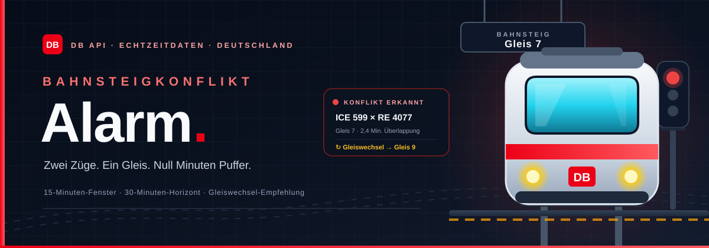
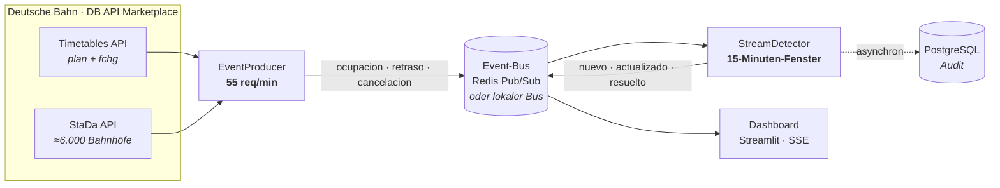

<div align="center">
  

  <br><br>

  
  
  
  
  
  
  
  

  <h3>Wenn zwei Züge dasselbe Gleis wollen.</h3>

  <p>
    <b>Echtzeit-Erkennung von Bahnsteigkonflikten</b> mit Live-Daten der Deutschen Bahn.<br>
    <sub>Event-Driven · 15-Minuten-Fenster · 30-Minuten-Horizont · Gleiswechsel-Empfehlung</sub>
  </p>

  <p>
    <a href="#das-problem">Das Problem</a> ·
    <a href="#architektur">Architektur</a> ·
    <a href="#deployment">Deployment</a> ·
    <a href="#api">API</a> ·
    <a href="#kurzfassung">Kurzfassung</a>
  </p>
</div>

---

<a name="das-problem"></a>
## 🚆 Das Problem

> **In einem ausgelasteten Netz reichen acht Minuten Verspätung, damit zwei Züge denselben Bahnsteig beanspruchen.**
>
> Der statische Fahrplan sieht das nicht. Der Reisende auch nicht. Wenn der Konflikt auf der Anzeigetafel auftaucht, rennen schon Menschen über den Bahnsteig.

**Bahnsteigkonflikt-Alarm** überwacht die Belegung jedes Gleises in Echtzeit und warnt **bevor** der Fahrplankonflikt eintritt. Jede Warnung zeigt Bahnhof, Gleis, die betroffenen **Zugnummern** und die Ursache:

- 🔴 **Konflikt** — zwei Belegungen überlappen sich tatsächlich.
- 🟠 **Risiko** — Puffer unter 3 Minuten, noch ohne Überlappung.
- 🔁 **Gleiswechsel** — der Konflikt bleibt bestehen: ein freies Ausweichgleis wird vorgeschlagen.

Keine simulierten Daten. Ohne Zugangsdaten der DB API sagt das Panel das und erfindet keine Warnungen.

<table>
<tr>
<td width="33%" valign="top">

### 📡 Live
Fahrplan und Änderungen (`fchg`) der DB Timetables API, dazu der StaDa-Katalog mit ≈6.000 deutschen Bahnhöfen.

</td>
<td width="33%" valign="top">

### 🧠 Mit Gedächtnis
Gleitende Fenster pro `(Bahnhof, Gleis)`, indiziert nach **Event-Time** — nicht nach Eingangszeit der Nachricht.

</td>
<td width="33%" valign="top">

### ⚡ Kein Polling
Event-Bus und SSE: Warnungen werden ins Panel geschoben, sobald der Detektor sie erzeugt.

</td>
</tr>
</table>

---

<a name="architektur"></a>
## 🛤️ Architektur



Der **Producer** rotiert die Anfragen über den Katalog mit einem globalen Token-Bucket (55 req/min, der Free-Plan erlaubt 60). Der **Detektor** hält das Fenster im Speicher und veröffentlicht die Warnungen. PostgreSQL speichert nur das Audit — es liegt nie im kritischen Pfad.

---

## 🧠 Wie ein Konflikt erkannt wird

Jeder Zug belegt sein Gleis von der Ankunft bis zur Abfahrt. Eine Verspätung verschiebt diese Belegung:

```text
ankunft_eff = ankunftszeit + verspaetung_min
abfahrt_eff = abfahrtszeit + verspaetung_min

ueberlappung = max(0, min(abfahrt_a, abfahrt_b) - max(ankunft_a, ankunft_b))
```

| Stufe | Bedingung | Lesart |
|---|---|---|
| 🔴 **Konflikt** | `ueberlappung > 0` und beide Belegungen bestätigt | Zwei Züge gleichzeitig auf demselben Gleis |
| 🟠 **Risiko** | `0 ≤ puffer < 180 s` | Abstand zwischen den Zügen zu kurz, noch ohne Überlappung |
| ⚪ Keine Warnung | `puffer ≥ 180 s` oder außerhalb des Horizonts | In den nächsten 30 Min. nichts Handlungsrelevantes |

Auch die **Ursache** wird berechnet, nicht geraten:

| Ursache | Regel |
|---|---|
| `efecto_dominó` | Ohne die Verspätung gäbe es keinen Konflikt; mit ihr schon |
| `retraso_contribuyente` | Der Konflikt bestand bereits, die Verspätung verschärft ihn |
| `solapamiento_programado` | Der Konflikt stand schon im Fahrplan |

Bleibt ein Konflikt länger als **45 s** bestehen, sucht der Detektor ein freies Gleis im selben Bahnhof und ergänzt `sugerencia_gleiswechsel` + `gleis_alternativo`. Ausfälle geben die Belegung sofort frei und lösen ihre Warnungen auf.

---

## ✨ Was dieses Projekt anders macht

| | |
|---|---|
| **Event-Time** | 15-Min.-Fenster pro `(Bahnhof, Gleis)` mit 120 s Toleranz für verspätete oder ungeordnete Events. |
| **Zwei Stufen** | Trennt den echten Konflikt vom bloßen Bahnsteig-Risiko. |
| **Dominoeffekt** | Ordnet den Konflikt der Verspätung zu, die ihn verursacht hat — nicht nur der Überlappung. |
| **Handlungsfähiger Vorschlag** | Bleibt nicht bei „es gibt ein Problem“: schlägt ein Ausweichgleis vor. |
| **Ganz Deutschland** | Vollständiger StaDa-Katalog mit intelligenter Rotation unter dem Rate-Limit des Free-Plans. |
| **Zwei Deployments** | Streamlit Cloud ohne Infrastruktur oder Docker mit Redis + PostgreSQL + SSE. |
| **Entkoppeltes Audit** | Die Historie geht nach PostgreSQL, ohne den Stream zu blockieren. |

### Gegenüber klassischem Polling

| | Polling alle 30 s | Dieses Projekt |
|---|---|---|
| Latenz | Bis zu 30 s | Sofortiger Push |
| Verspätete Events | Gehen verloren oder werden doppelt verarbeitet | Fenster nach Event-Time |
| Last | Ständige Abfragen | Kontrolliertes API-Budget |
| Warnungen | „Momentaufnahme“-Status | `nuevo` / `actualizado` / `resuelto` |

---

<a name="deployment"></a>
## 🚀 Deployment

### A — Streamlit Cloud (ohne Redis, ohne PostgreSQL)

Die gesamte Pipeline läuft im Streamlit-Prozess mit einem lokalen Bus.

1. Repository forken oder klonen.
2. In [Streamlit Community Cloud](https://share.streamlit.io) eine App anlegen mit:
   - **Main file path:** `app/main.py`
   - **Branch:** `main`
3. Unter **Settings → Secrets** ergänzen:

   ```toml
   DB_CLIENT_ID = "deine-client-id"
   DB_API_KEY   = "dein-api-key"
   ```

4. Deployen. Die Zugangsdaten gibt es bei [developers.deutschebahn.com](https://developers.deutschebahn.com) mit Abo der **Timetables API** und der **Station Data API**.

> [!TIP]
> `requirements.txt` installiert nur `streamlit` und `requests`. `psycopg2` bleibt bewusst draußen: Es hat kein Wheel für Python 3.13+ und hat das Streamlit-Cloud-Deployment zum Absturz gebracht.

### B — Docker (FastAPI + SSE + Redis + PostgreSQL)

```bash
cp .env.example .env        # PowerShell: Copy-Item .env.example .env
# .env mit DB_CLIENT_ID und DB_API_KEY ausfüllen

docker compose up -d --build
```

| Dienst | URL / Port |
|---|---|
| Dashboard + API | <http://localhost:8000> |
| PostgreSQL | `localhost:5434` |
| Redis | `localhost:6380` |

```bash
docker compose logs -f app   # Stream live verfolgen
docker compose down          # alles stoppen
```

> [!IMPORTANT]
> Ohne `DB_CLIENT_ID` und `DB_API_KEY` gibt es keine Daten. Das Projekt hat keinen Simulationsmodus: Das Panel weist auf die fehlenden Zugangsdaten hin.

---

<a name="api"></a>
## 🔌 API

| Methode | Route | Beschreibung |
|---|---|---|
| `GET` | `/` | HTML-Panel mit SSE |
| `GET` | `/api/stream/conflictos` | SSE-Stream: `snapshot`, `nuevo`, `actualizado`, `resuelto` |
| `GET` | `/api/conflictos` | Historie aus PostgreSQL (`?minutes=15&estado=activo`) |
| `GET` | `/api/estado` | Live-Status des Detektors (Speicher) |
| `GET` | `/api/estaciones` | StaDa-Katalog: Regionen und Städte |
| `GET` | `/api/metrics` | Metriken von Producer und Detektor |
| `GET` | `/api/health` | Status von DB, Redis und Zugangsdaten (`503` bei Beeinträchtigung) |

Beispiel einer Warnung:

```json
{
  "estacion_id": "8000105",
  "nombre_estacion": "Frankfurt(Main) Hbf",
  "gleis": "7",
  "tren_1_numero": "599",
  "tren_1_categoria": "ICE",
  "tren_2_numero": "4077",
  "tren_2_categoria": "RE",
  "nivel": "conflicto",
  "causa": "efecto_dominó",
  "solape_min": 2.4,
  "retraso_min": 12,
  "sugerencia_gleiswechsel": true,
  "gleis_alternativo": "9"
}
```

---

## 🗂️ Projektstruktur

```text
.
├── app/
│   ├── main.py        # Streamlit-Cloud-Dashboard
│   ├── api.py         # FastAPI + SSE (Docker)
│   ├── motor.py       # Singleton: Producer + Detektor in einem Thread
│   ├── ingest.py      # DB-API-Producer, Rate-Limit und Rotation
│   ├── detector.py    # Stream-Processor: Fenster, Stufen, Gleiswechsel
│   ├── events.py      # Event-Vertrag
│   ├── bus.py         # Redis Pub/Sub oder lokaler In-Memory-Bus
│   ├── db.py          # PostgreSQL-Audit (optional)
│   └── static/        # HTML-Panel mit SSE
├── sql/schema.sql     # Schema + idempotente Migrationen
├── assets/banner.svg  # Dieses Banner
├── docker-compose.yml
├── Dockerfile
└── requirements*.txt
```

---

## ⚙️ Konfiguration

| Variable | Default | Beschreibung |
|---|---|---|
| `DB_CLIENT_ID` / `DB_API_KEY` | — | Zugangsdaten des DB API Marketplace |
| `DB_RATE_PER_MIN` | `55` | Anfragen/Min. (Limit des Free-Plans: 60) |
| `REDIS_URL` | `redis://redis:6379/0` | Event-Bus |
| `BUS_LOCAL` | `0` | `1` = In-Memory-Bus (Streamlit Cloud) |
| `AUDIT_ENABLED` | `1` | `0` = ohne PostgreSQL |
| `VENTANA_SEG` | `900` | Gleitendes Fenster (15 Min.) |
| `LATE_TOLERANCE_SEG` | `120` | Toleranz für verspätete Events |
| `UMBRAL_SEGUNDOS` | `180` | Schwelle für *Risiko* (3 Min.) |
| `HORIZONTE_SEG` | `1800` | Prognosehorizont (30 Min.) |
| `GLEISWECHEL_UMBRAL_SEG` | `45` | Dauer, bevor ein Gleiswechsel vorgeschlagen wird |
| `STADA_MAX_ESTACIONES` | `0` | `0` = alle; nützlich für lokale Tests |

---

## 📊 Daten und Lizenz

- **Quelle:** [Deutsche Bahn – DB API Marketplace](https://developers.deutschebahn.com) — *Timetables API v1* + *Station Data API v2*.
- **Datenlizenz:** [CC BY 4.0](https://creativecommons.org/licenses/by/4.0/).
- **Code:** MVP zu Bildungs- und Demonstrationszwecken.

**Haftungsausschluss:** Unabhängiges Projekt. Nicht mit der Deutschen Bahn AG verbunden, von ihr gesponsert oder unterstützt. Die Warnungen sind Schätzungen aus öffentlichen Daten und ersetzen weder offizielle Hinweise noch betriebliche Entscheidungen.

### Ehrliche Grenzen

- Der Free-Plan erlaubt 60 req/min: Nicht jeder Bahnhof lässt sich jede Sekunde abfragen. Die Rotation priorisiert Bahnhöfe mit Aktivität und hohen Kategorien.
- Die öffentliche API bildet nicht das gesamte Betriebsgeschehen ab (Abstellgleise, Rangierfahrten, Bahnsteigreservierungen).
- Das System **empfiehlt** einen Gleiswechsel; es vergibt keine Gleise und greift nicht in den Betrieb ein.
- Ohne gültige Zugangsdaten bleibt das Panel leer: Das ist eine Designentscheidung, kein Fehler.

---

## 🗺️ Roadmap

- [x] Live-Ingestion `plan` + `fchg` mit Rate-Limit
- [x] Fenster nach *Event-Time* inkl. verspäteter Events
- [x] Erkennung von Dominoeffekt und Ausfällen
- [x] SSE + PostgreSQL-Audit
- [x] Duales Deployment: Streamlit Cloud und Docker
- [ ] Unit-Tests des Detektors mit `pytest`
- [ ] Push-Benachrichtigungen (Telegram / Matrix)
- [ ] Verspätungsprognose mit ML
- [ ] Historische Heatmap pro Bahnhof und Gleis
- [ ] Weitere Betreiber (ÖBB, SBB)

---

<a name="kurzfassung"></a>
## 🇩🇪 Kurzfassung

<details>
<summary><b>Bahnsteigkonflikt-Alarm — kurz erklärt</b></summary>

<br>

**Das Problem:** In einem belasteten Netz reichen wenige Minuten Verspätung, damit zwei Züge denselben Bahnsteig beanspruchen. Der statische Fahrplan zeigt diesen Konflikt nicht — und wenn er im Betrieb sichtbar wird, ist es oft zu spät.

**Die Lösung:** Ein event-getriebener MVP, der die Gleisbelegung aus der öffentlichen **DB Timetables API** und dem **StaDa**-Katalog in Echtzeit auswertet. Gleitende 15-Minuten-Fenster pro `(Bahnhof, Gleis)` erkennen Überlappungen, bevor sie passieren. Der 30-Minuten-Horizont sorgt dafür, dass nur umsetzbare Warnungen erscheinen.

**Die Besonderheit:**

- unterscheidet **Konflikt** (echte Überlappung) von **Risiko** (Puffer < 3 Min.),
- ordnet die Ursache zu: **Dominoeffekt**, beitragende Verspätung oder geplante Überlappung,
- schlägt nach 45 Sekunden ein freies **Ausweichgleis** vor,
- verarbeitet verspätete und ungeordnete Events über Event-Time-Fenster,
- läuft entweder kostenlos auf Streamlit Cloud oder mit Docker, Redis und PostgreSQL.

**Grenzen:** reine Warn- und Beratungsfunktion, keine Gleisvergabe, kein Ersatz für die offiziellen DB-Systeme. Ohne API-Zugangsdaten werden bewusst keine Daten angezeigt.

</details>

---

<div align="center">
  <sub>Gebaut mit ❤️, Python und einer gesunden Portion Gleis 7.</sub><br>
  <sub>Kein offizielles Produkt der Deutschen Bahn AG · Daten: DB API Marketplace · CC BY 4.0</sub>
</div>
