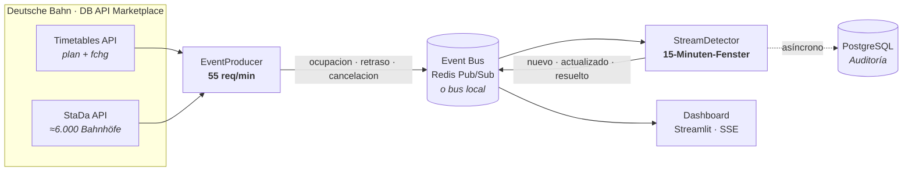

<div align="center">
  

  <br><br>

  
  
  
  
  
  
  
  

  <h3>Wenn zwei Züge dasselbe Gleis wollen.</h3>

  <p>
    <b>Detección de conflictos de andén en tiempo real</b> con datos en vivo de la Deutsche Bahn.<br>
    <sub>Event-Driven · 15-Minuten-Fenster · 30-Minuten-Horizont · Gleiswechsel-Empfehlung</sub>
  </p>

  <p>
    <a href="#el-problema">El problema</a> ·
    <a href="#arquitectura">Arquitectura</a> ·
    <a href="#despliegue">Despliegue</a> ·
    <a href="#api">API</a> ·
    <a href="#kurzfassung-auf-deutsch">Deutsch</a>
  </p>
</div>

---

<a name="el-problema"></a>
## 🚆 El problema

> **En una red saturada, ocho minutos de retraso bastan para que dos trenes reclamen el mismo andén.**
>
> El plan estático no lo ve. El viajero tampoco. Cuando el conflicto aparece en el tablero, ya hay gente corriendo por el andén.

**Bahnsteigkonflikt-Alarm** vigila la ocupación de cada Gleis en tiempo real y avisa **antes** de que el choque de horarios ocurra. Para cada alerta muestra la estación, el andén, los **números de tren** implicados y la causa:

- 🔴 **Konflikt** — dos ocupaciones se solapan de verdad.
- 🟠 **Risiko** — margen inferior a 3 minutos, aún sin solape.
- 🔁 **Gleiswechsel** — el conflicto persiste: se propone un andén alternativo libre.

No hay datos simulados. Si no hay credenciales de la DB API, el panel lo dice y no inventa alertas.

<table>
<tr>
<td width="33%" valign="top">

### 📡 En vivo
Plan y cambios (`fchg`) de la DB Timetables API, más el catálogo StaDa de ≈6.000 estaciones alemanas.

</td>
<td width="33%" valign="top">

### 🧠 Con memoria
Ventanas deslizantes por `(estación, Gleis)` indexadas por **event time**, no por hora de llegada del mensaje.

</td>
<td width="33%" valign="top">

### ⚡ Sin polling
Bus de eventos y SSE: las alertas se empujan al panel en cuanto el detector las produce.

</td>
</tr>
</table>

---

<a name="arquitectura"></a>
## 🛤️ Arquitectura



El **productor** rota peticiones sobre el catálogo con un token bucket global (55 req/min, el plan Free permite 60). El **detector** mantiene la ventana en memoria y publica las alertas. PostgreSQL solo guarda auditoría: nunca está en el camino crítico.

---

## 🧠 Cómo se detecta un conflicto

Cada tren ocupa su andén desde que llega hasta que sale. El retraso desplaza esa ocupación:

```text
llegada_eff = hora_llegada + retraso_min
salida_eff  = hora_salida  + retraso_min

solape = max(0, min(salida_a, salida_b) - max(llegada_a, llegada_b))
```

| Nivel | Condición | Lectura |
|---|---|---|
| 🔴 **Konflikt** | `solape > 0` y ambas ocupaciones confirmadas | Dos trenes en el mismo Gleis a la vez |
| 🟠 **Risiko** | `0 ≤ margen < 180 s` | Intervalo entre trenes demasiado corto, sin solape todavía |
| ⚪ Sin alerta | `margen ≥ 180 s` o fuera del horizonte | Nada accionable en los próximos 30 min |

La **causa** también se calcula, no se adivina:

| Causa | Regla |
|---|---|
| `efecto_dominó` | Sin el retraso no había conflicto; con él, sí |
| `retraso_contribuyente` | Ya había conflicto y el retraso lo agrava |
| `solapamiento_programado` | El choque ya estaba en el plan |

Si un conflicto sigue vivo tras **45 s**, el detector busca un Gleis libre en la misma estación y añade `sugerencia_gleiswechsel` + `gleis_alternativo`. Las cancelaciones liberan la ocupación al instante y resuelven sus alertas.

---

## ✨ Lo que lo hace diferente

| | |
|---|---|
| **Tiempo de evento** | Ventana de 15 min por `(estación, Gleis)` con tolerancia de 120 s para eventos tardíos o desordenados. |
| **Dos niveles** | Separa el conflicto real del simple riesgo de cabeza de andén. |
| **Efecto dominó** | Atribuye el conflicto al retraso que lo provocó, no solo al solape. |
| **Propuesta accionable** | No se queda en “hay un problema”: sugiere un Gleis alternativo. |
| **Toda Alemania** | Catálogo StaDa completo con rotación inteligente bajo el rate limit del plan Free. |
| **Doble despliegue** | Streamlit Cloud sin infraestructura, o Docker con Redis + PostgreSQL + SSE. |
| **Auditoría desacoplada** | El historial va a PostgreSQL sin bloquear el stream. |

### Frente al polling clásico

| | Polling cada 30 s | Este proyecto |
|---|---|---|
| Latencia | Hasta 30 s | Push inmediato |
| Eventos tardíos | Se pierden o duplican | Ventana por event time |
| Carga | Consultas constantes | Presupuesto de API controlado |
| Alertas | Estado “foto” | `nuevo` / `actualizado` / `resuelto` |

---

<a name="despliegue"></a>
## 🚀 Despliegue

### A — Streamlit Cloud (sin Redis, sin PostgreSQL)

Todo el pipeline corre dentro del proceso de Streamlit con un bus local.

1. Haz fork o clona el repositorio.
2. En [Streamlit Community Cloud](https://share.streamlit.io), crea una app con:
   - **Main file path:** `app/main.py`
   - **Branch:** `main`
3. En **Settings → Secrets**, añade:

   ```toml
   DB_CLIENT_ID = "tu-client-id"
   DB_API_KEY   = "tu-api-key"
   ```

4. Despliega. Las credenciales se obtienen en [developers.deutschebahn.com](https://developers.deutschebahn.com) con suscripción a **Timetables API** y **Station Data API**.

> [!TIP]
> `requirements.txt` solo instala `streamlit` y `requests`. `psycopg2` queda fuera a propósito: no tiene wheel para Python 3.13+ y rompía el despliegue de Streamlit Cloud.

### B — Docker (FastAPI + SSE + Redis + PostgreSQL)

```bash
cp .env.example .env        # PowerShell: Copy-Item .env.example .env
# edita .env con DB_CLIENT_ID y DB_API_KEY

docker compose up -d --build
```

| Servicio | URL / puerto |
|---|---|
| Dashboard + API | <http://localhost:8000> |
| PostgreSQL | `localhost:5434` |
| Redis | `localhost:6380` |

```bash
docker compose logs -f app   # ver el stream en directo
docker compose down          # parar todo
```

> [!IMPORTANT]
> Sin `DB_CLIENT_ID` y `DB_API_KEY` no hay datos. El proyecto no incluye un modo de simulación: el panel avisa de que faltan credenciales.

---

<a name="api"></a>
## 🔌 API

| Método | Ruta | Descripción |
|---|---|---|
| `GET` | `/` | Panel HTML con SSE |
| `GET` | `/api/stream/conflictos` | Stream SSE: `snapshot`, `nuevo`, `actualizado`, `resuelto` |
| `GET` | `/api/conflictos` | Historial desde PostgreSQL (`?minutes=15&estado=activo`) |
| `GET` | `/api/estado` | Estado en vivo del detector (memoria) |
| `GET` | `/api/estaciones` | Catálogo StaDa: regiones y ciudades |
| `GET` | `/api/metrics` | Métricas del productor y del detector |
| `GET` | `/api/health` | Salud de DB, Redis y credenciales (`503` si degradado) |

Ejemplo de alerta:

```json
{
  "estacion_id": "8000105",
  "nombre_estacion": "Frankfurt(Main) Hbf",
  "gleis": "7",
  "tren_1_numero": "599",
  "tren_1_categoria": "ICE",
  "tren_2_numero": "4077",
  "tren_2_categoria": "RE",
  "nivel": "conflicto",
  "causa": "efecto_dominó",
  "solape_min": 2.4,
  "retraso_min": 12,
  "sugerencia_gleiswechsel": true,
  "gleis_alternativo": "9"
}
```

---

## 🗂️ Estructura del proyecto

```text
.
├── app/
│   ├── main.py        # Dashboard Streamlit Cloud
│   ├── api.py         # FastAPI + SSE (Docker)
│   ├── motor.py       # Singleton productor + detector en un hilo
│   ├── ingest.py      # Productor DB API, rate limit y rotación
│   ├── detector.py    # Stream processor: ventanas, niveles, Gleiswechsel
│   ├── events.py      # Contrato de eventos
│   ├── bus.py         # Redis Pub/Sub o bus local en memoria
│   ├── db.py          # Auditoría PostgreSQL (opcional)
│   └── static/        # Panel HTML con SSE
├── sql/schema.sql     # Esquema + migraciones idempotentes
├── assets/banner.svg  # Este banner
├── docker-compose.yml
├── Dockerfile
└── requirements*.txt
```

---

## ⚙️ Configuración

| Variable | Default | Descripción |
|---|---|---|
| `DB_CLIENT_ID` / `DB_API_KEY` | — | Credenciales del DB API Marketplace |
| `DB_RATE_PER_MIN` | `55` | Peticiones/min (límite del plan Free: 60) |
| `REDIS_URL` | `redis://redis:6379/0` | Bus de eventos |
| `BUS_LOCAL` | `0` | `1` = bus en memoria (Streamlit Cloud) |
| `AUDIT_ENABLED` | `1` | `0` = sin PostgreSQL |
| `VENTANA_SEG` | `900` | Ventana deslizante (15 min) |
| `LATE_TOLERANCE_SEG` | `120` | Tolerancia para eventos tardíos |
| `UMBRAL_SEGUNDOS` | `180` | Umbral de *Risiko* (3 min) |
| `HORIZONTE_SEG` | `1800` | Horizonte de predicción (30 min) |
| `GLEISWECHEL_UMBRAL_SEG` | `45` | Persistencia antes de sugerir cambio de Gleis |
| `STADA_MAX_ESTACIONES` | `0` | `0` = todas; útil para pruebas locales |

---

## 📊 Datos y licencia

- **Fuente:** [Deutsche Bahn – DB API Marketplace](https://developers.deutschebahn.com) — *Timetables API v1* + *Station Data API v2*.
- **Licencia de los datos:** [CC BY 4.0](https://creativecommons.org/licenses/by/4.0/).
- **Código:** MVP con fines educativos y de demostración.

**Aviso legal:** proyecto independiente. No está afiliado, patrocinado ni respaldado por Deutsche Bahn AG. Las alertas son estimaciones calculadas a partir de datos públicos y no sustituyen las indicaciones oficiales ni las decisiones de circulación.

### Limitaciones honestas

- El plan Free permite 60 req/min: no se puede consultar cada estación cada segundo. La rotación prioriza estaciones con actividad y categorías altas.
- La API pública no expone toda la operación interna (apartaderos, maniobras, reservas de andén).
- El sistema **aconseja** un cambio de Gleis; no reasigna andenes ni interviene en la circulación.
- Sin credenciales válidas, el panel queda vacío: es una decisión de diseño, no un fallo.

---

## 🗺️ Roadmap

- [x] Ingesta en vivo `plan` + `fchg` con rate limit
- [x] Ventanas por *event time* con eventos tardíos
- [x] Detección de efecto dominó y cancelaciones
- [x] SSE + auditoría PostgreSQL
- [x] Despliegue dual: Streamlit Cloud y Docker
- [ ] Tests unitarios del detector con `pytest`
- [ ] Notificaciones push (Telegram / Matrix)
- [ ] Predicción de retrasos con ML
- [ ] Mapa de calor histórico por estación y Gleis
- [ ] Otros operadores (ÖBB, SBB)

---

<a name="kurzfassung-auf-deutsch"></a>
## 🇩🇪 Kurzfassung auf Deutsch

<details>
<summary><b>Bahnsteigkonflikt-Alarm — kurz erklärt</b></summary>

<br>

**Das Problem:** In einem belasteten Netz reichen wenige Minuten Verspätung, damit zwei Züge denselben Bahnsteig beanspruchen. Der statische Fahrplan zeigt diesen Konflikt nicht — und wenn er im Betrieb sichtbar wird, ist es oft zu spät.

**Die Lösung:** Ein event-getriebener MVP, der die Gleisbelegung aus der öffentlichen **DB Timetables API** und dem **StaDa**-Katalog in Echtzeit auswertet. Gleitende 15-Minuten-Fenster pro `(Bahnhof, Gleis)` erkennen Überlappungen, bevor sie passieren. Der 30-Minuten-Horizont sorgt dafür, dass nur umsetzbare Warnungen erscheinen.

**Die Besonderheit:**

- unterscheidet **Konflikt** (echte Überlappung) von **Risiko** (Puffer < 3 Min.),
- ordnet die Ursache zu: **Dominoeffekt**, beitragende Verspätung oder geplante Überlappung,
- schlägt nach 45 Sekunden ein freies **Ausweichgleis** vor,
- verarbeitet verspätete und ungeordnete Events über Event-Time-Fenster,
- läuft entweder kostenlos auf Streamlit Cloud oder mit Docker, Redis und PostgreSQL.

**Grenzen:** reine Warn- und Beratungsfunktion, keine Gleisvergabe, kein Ersatz für die offiziellen DB-Systeme. Ohne API-Zugangsdaten werden bewusst keine Daten angezeigt.

</details>

---

<div align="center">
  <sub>Gebaut mit ❤️, Python und einer gesunden Portion Gleis 7.</sub><br>
  <sub>Kein offizielles Produkt der Deutschen Bahn AG · Daten: DB API Marketplace · CC BY 4.0</sub>
</div>
